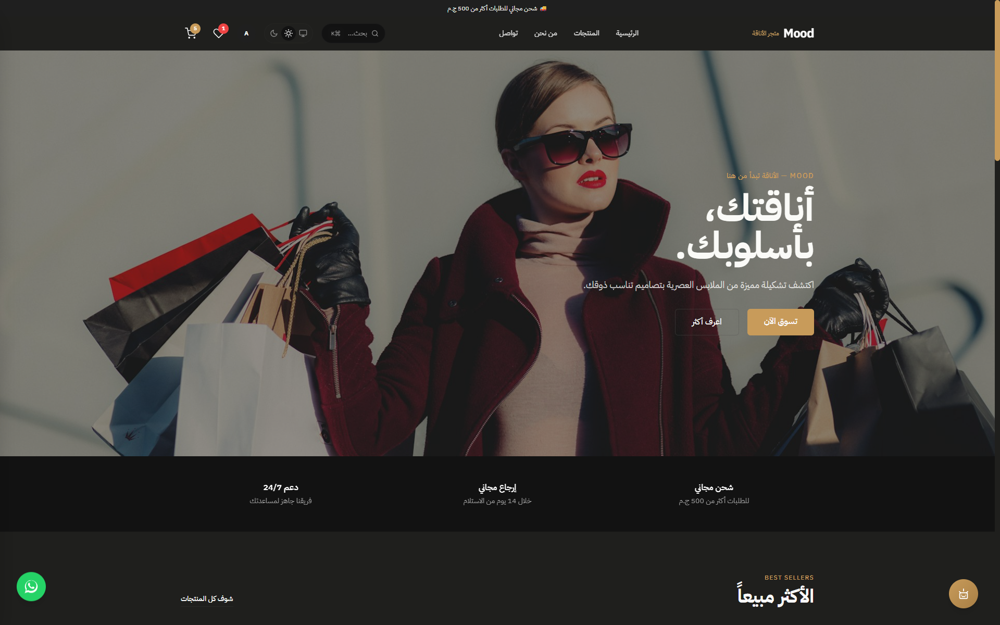
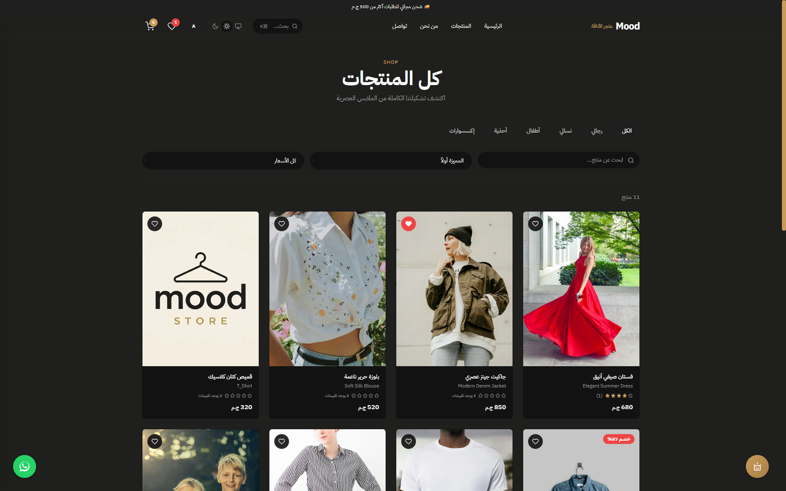
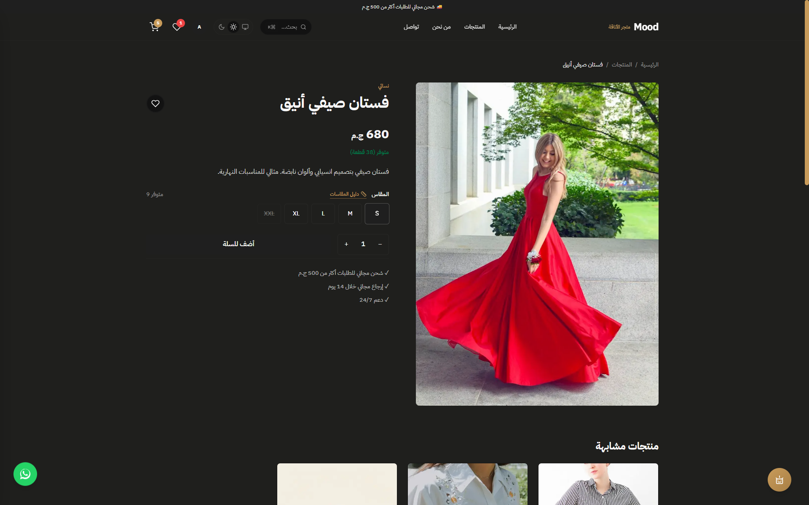
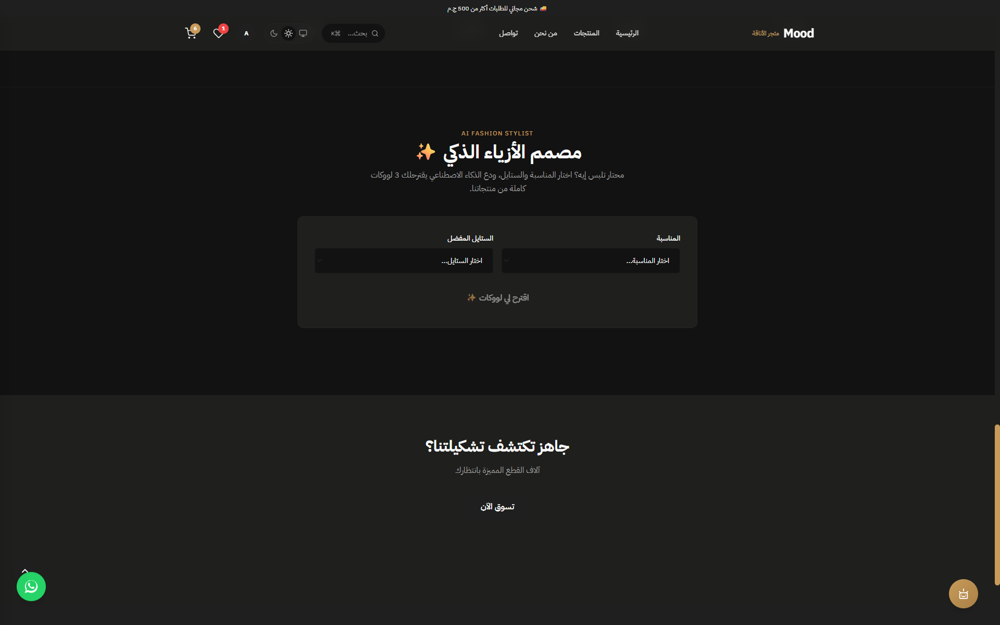
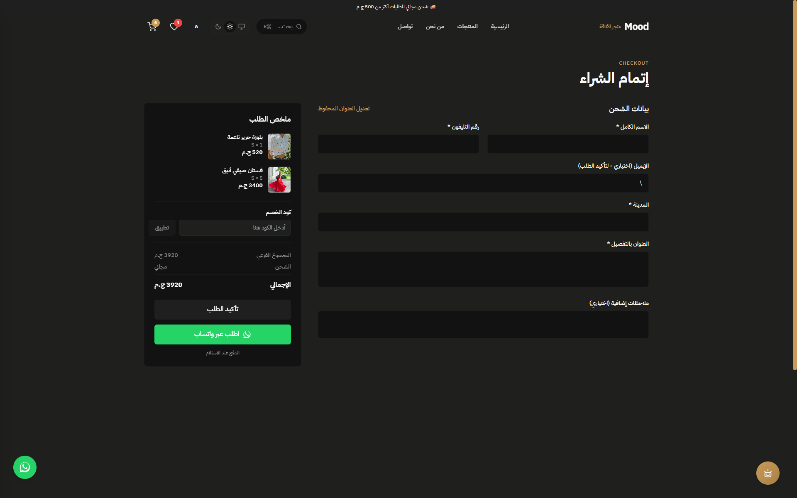
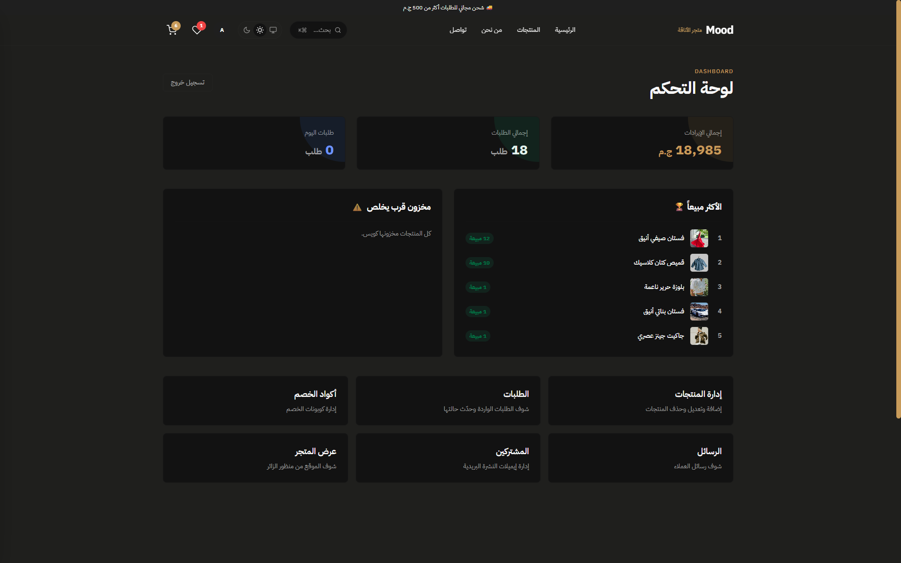

<div align="center">
  

# 🛍️ Mood Store | متجر الأناقة

**A highly scalable, secure, and feature-rich E-Commerce platform built for the modern web.**

[](https://nextjs.org/)
[](https://www.typescriptlang.org/)
[](https://supabase.com/)
[](https://tailwindcss.com/)
[](https://vercel.com/)

🔗 **[Live Demo](https://mood-khaki-beta.vercel.app)** | 👨‍💻 **[Admin Panel](https://mood-khaki-beta.vercel.app/admin)**

</div>

---

## 📖 About The Project

**Mood Store** is a fully-functional, RTL-first (Right-to-Left) E-Commerce platform designed to provide a seamless shopping experience. It goes beyond basic CRUD operations by integrating **AI-powered fashion styling**, automated marketing tools, and a highly secure admin dashboard.

This project was built to demonstrate **Enterprise-level architecture** using modern technologies, focusing on **Security, Performance, and Mobile-First UX**.

---

## 📸 Screenshots

| 🏠 Home Page | 🛒 Products Page |
| :---: | :---: |
|  |  |

| 🔍 Product Details | 🤖 AI Stylist |
| :---: | :---: |
|  |  |

| 💳 Checkout Flow | 📊 Admin Dashboard |
| :---: | :---: |
|  |  |

| 📱 Mobile Experience |
| :---: |
|  |

---

## ✨ Key Features

### 🛍️ Customer Experience (Frontend)
*   **Mobile-First UI/UX:** Optimized for mobile with full-screen menus, bottom-sheet cart & filters, and swipeable product galleries.
*   **AI Fashion Stylist:** Recommends complete outfits based on user preference and real-time inventory (Powered by Google Gemini).
*   **Advanced Search & Filtering:** Instant search autocomplete, price filtering, and category sorting.
*   **Seamless Checkout:** Supports **Guest Checkout** (no account required) and **WhatsApp Checkout** for local market convenience.
*   **Coupons & Discounts:** Dynamic coupon validation with min-order logic.
*   **Wishlist Synchronization:** Syncs seamlessly with the user's account across devices.
*   **Order Tracking:** Guests can track their orders using their order number.
*   **PWA Ready:** Installable on mobile devices with offline support.
*   **Dark Mode:** Fully integrated system-aware theme.

### 🛠️ Admin Dashboard
*   **Advanced Analytics:** Revenue tracking, top-selling products, and low-stock alerts.
*   **Real-time Notifications:** Bell icon with smart unread counter for new pending orders.
*   **Product Management:** Full CRUD with dynamic image uploading, WebP compression, and SEO fields (Meta Title/Description).
*   **Order Management:** Update statuses, view details, and **print professional invoices**.
*   **Marketing Tools:** Manage **Coupons**, view **Newsletter Subscribers** (with CSV export), and handle contact messages.
*   **Audit Logs (New):** Track every sensitive action performed by admins (e.g., changing order status, deleting products) with timestamps.
*   **Automated Cron Jobs:** Sends **Abandoned Cart Recovery** emails automatically via Vercel Cron.

---

## 🛡️ Security & Architecture Highlights

This project follows strict security standards to ensure data integrity and user safety:

*   **Strict Data Validation:** `Zod` schema validation on both client and server sides to prevent invalid data injection.
*   **Database Security (RLS):** Strict Row Level Security policies in Supabase. Users can only access their own data.
*   **Race Condition Prevention:** Stock deduction is handled via atomic PostgreSQL `RPC` functions with `FOR UPDATE` locks.
*   **Advanced Rate Limiting:** API endpoints (Chat, Orders, Contact) and Admin routes are protected by **Upstash Redis** to prevent DoS attacks.
*   **File Upload Security:** Binary signature validation (`file-type`) to prevent malicious file uploads, plus automatic image compression using `Sharp`.
*   **Error Monitoring:** Real-time error tracking and performance tracing via **Sentry**.
*   **Security Headers:** Implemented `X-Frame-Options`, `X-Content-Type-Options`, and `Permissions-Policy`.
*   **Admin Security:** Protected by a 5-attempt login rate limit, secret code validation for password changes, and a secure password recovery mechanism.

---

## 🛠️ Tech Stack

*   **Framework:** Next.js 16 (App Router, Server Components)
*   **Language:** TypeScript
*   **Styling:** Tailwind CSS, Framer Motion
*   **Database & Auth:** Supabase (PostgreSQL)
*   **AI Integration:** Google Gemini AI (`@google/genai`)
*   **Email Service:** Brevo
*   **Rate Limiting:** Upstash Redis
*   **Error Tracking:** Sentry
*   **Image Processing:** Sharp
*   **Deployment:** Vercel

---

## 🚀 Getting Started

To run this project locally, follow these steps:

1.  **Clone the repository:**
    ```bash
    git clone https://github.com/abdelrhmansadeq/mood.git
    cd mood
    ```

2.  **Install dependencies:**
    ```bash
    npm install
    ```

3.  **Set up Environment Variables:**
    Create a `.env.local` file in the root directory and add the following keys:
    ```env
    # Supabase
    NEXT_PUBLIC_SUPABASE_URL=your_supabase_url
    NEXT_PUBLIC_SUPABASE_ANON_KEY=your_anon_key
    SUPABASE_SERVICE_ROLE_KEY=your_service_role_key

    # AI & Emails
    GEMINI_API_KEY=your_gemini_api_key
    BREVO_API_KEY=your_brevo_api_key
    BREVO_SENDER_EMAIL=your_email
    BREVO_SENDER_NAME="Mood"
    BREVO_ADMIN_EMAIL=admin_email

    # Security & Rate Limiting
    UPSTASH_REDIS_REST_URL=your_upstash_url
    UPSTASH_REDIS_REST_TOKEN=your_upstash_token
    CRON_SECRET=your_cron_secret
    ADMIN_SECRET_CODE=your_secret_code

    # Monitoring
    NEXT_PUBLIC_SENTRY_DSN=your_sentry_dsn
    ```

4.  **Run the development server:**
    ```bash
    npm run dev
    ```

5.  Open [http://localhost:3000](http://localhost:3000) in your browser.

---
<div align="center">
  <b>Built with ❤️ by <a href="https://github.com/abdelrhmansadeq">Abdelrhman Sadeq</a></b>
</div>